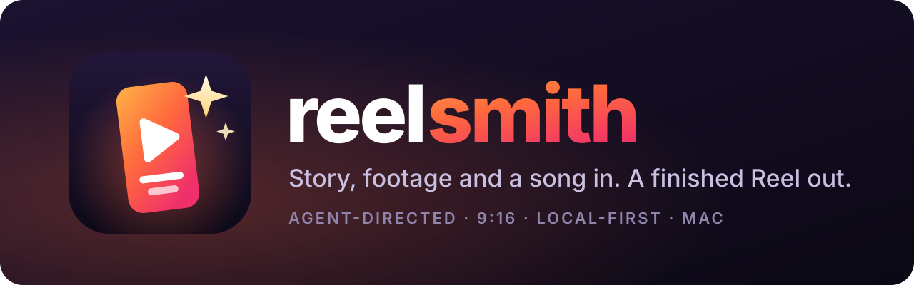
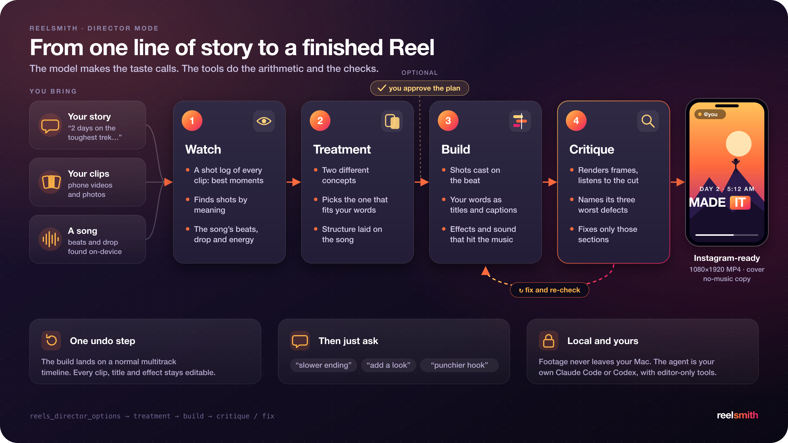
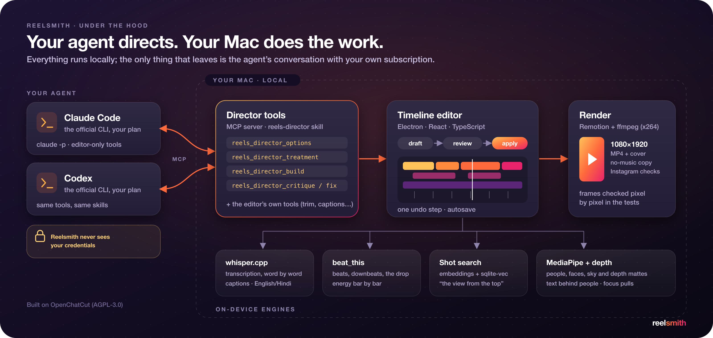

<p align="center">
  
</p>

<p align="center">
  <b>An AI director for Instagram Reels.</b> Tell it the story, give it your clips and a song, and it cuts the reel:<br>
  picks the shots, lands them on the beat, writes the titles and captions, then checks its own work.
</p>

<p align="center">
  <a href="#director-mode">Director mode</a> ·
  <a href="#why-reelsmith">Why it's different</a> ·
  <a href="#built-with-ai-agents">Built with AI agents</a> ·
  <a href="#getting-started">Getting started</a> ·
  <a href="ROADMAP.md">Roadmap</a>
</p>

---

## Why Reelsmith

Making a good Reel from a weekend of phone footage takes hours: scrubbing 40 clips for the three good seconds in each, cutting on the beat, timing text, picking transitions that don't look cheap. Template apps are fast but every reel looks like the template. Chat-based AI editors follow instructions ("cut here, add a caption"), but they don't *direct*.

Reelsmith treats the AI as the **director**, not an assistant:

- **You give intent, not instructions.** One line of story ("2 days on the toughest trek in Maharashtra: climbed at dawn, cooked on the cliff, made it to the top"), your clips and a song. That's the whole brief.
- **It watches the footage first.** Every clip gets a shot log: what it shows, its best moments, where it moves, where someone talks, the soft or dark seconds to avoid. Shots are found by meaning ("the view from the top"), not by filename.
- **It commits to a concept.** It writes two genuinely different treatments, picks the one that fits your words, and (if you want) shows you the plan before it builds.
- **It critiques itself.** After the build it renders frames from every section, listens to the cut "with eyes closed" (a drop on nothing, a line between beats), names its three worst defects and fixes them.
- **It's local and yours.** Footage never leaves your Mac. Transcription, beat tracking, shot search, and person and depth mattes all run on-device. The agent is your own Claude Code or Codex CLI with editor-only tools; the app never sees your credentials.
- **Everything stays editable.** The result is a normal multitrack timeline, applied as one undo step. Keep refining in chat or by hand.

### How it compares to the editor it grew from

Reelsmith started as a fork of [OpenChatCut](https://github.com/0xsline/OpenChatCut), an open-source, agent-native video editor, and kept its solid foundation (timeline, Remotion export, local ML engines, MCP tools). What it adds is a point of view:

| | OpenChatCut | Reelsmith |
|---|---|---|
| **Built for** | Any video | Vertical short-form, Instagram Reels first |
| **The AI's role** | Assistant: follows edit requests | **Director:** treatment → build → self-critique → fix |
| **Finding shots** | You place clips | Shot log, best moments, search by meaning, timed shot lists |
| **Rhythm** | Beat tools | Builds to the drop, varied pace, punch-ins, burst hooks |
| **Looks and moves** | Effects, LUTs, transitions | Plus depth lens blur and focus pulls, sky and world swaps, silhouette portals, smooth slow motion, text behind people |
| **Promos** | — | Promo reels from a website: punch captions, CTA end card |
| **Output** | General export | Instagram-ready checks, a music-free copy for Instagram's own audio, the same reel re-shaped to 4:5, 1:1 or 16:9 |

---

## Director mode

<p align="center">
  
</p>

Each stage is a tool the agent calls (`reels_director_options` → `reels_director_treatment` → `reels_director_build` → `reels_director_critique` / `reels_director_fix`), guided by the `reels-director` skill. **The model makes the taste calls; the tools do the arithmetic and the checks.** Beat grids, shot timing, safe zones, loudness and render validation are deterministic code, so the agent can't get them wrong.

### Under the hood

<p align="center">
  
</p>

---

## Built with AI agents

Reelsmith is also an experiment in **how far one developer can go by directing AI coding agents well**, the same idea the product applies to video. In about three weeks after forking it gained 300+ commits, most of them pair-written with Claude Code (some with Codex). What made that work:

- **Spec before code.** A planning package (feature inventory, research notes, JSON schemas, architecture diagrams) came first. Then a backlog in [ROADMAP.md](ROADMAP.md) where every item (`RS-xxx`) has a concrete **acceptance check**, worked milestone by milestone. An item is ticked only when its check passes in the real app.
- **Rules the agent can follow.** [CLAUDE.md](CLAUDE.md) tells coding agents where new code goes, how to keep upstream merges cheap (every touched upstream file is logged in [UPSTREAM_PATCHES.md](reelsmith-docs/UPSTREAM_PATCHES.md)), which tests to run when, and what never to touch (credentials).
- **Tests as the safety net.** 160+ new `*.verify.ts` suites, about 790 test segments in total, including real renders: frames are rendered and compared pixel by pixel, exports are probed with ffmpeg. `npm run verify:affected` runs only the suites an edit touches, so the agent gets feedback in seconds.
- **Measure, don't guess.** Decisions are backed by numbers the agent collected: x264 vs VideoToolbox at equal bitrate (SSIM .951 vs .945), the export bitrate change (SSIM .945 → .969 on phone footage), calibrated thresholds for shot search, and a profile showing ~87% of a slow edit's output tokens were hidden reasoning, which led to an effort setting and batched tools.
- **Design the AI's tools for the AI.** Tool results are kept small enough to reach the model intact, skills are split into short files the agent loads when needed, and every edit goes through a draft that is reviewed and applied as one undo step, so an agent mistake is always one ⌘Z away.

---

## Getting started

Reelsmith runs on **macOS (Apple Silicon or Intel)**. Setup takes about 10 minutes, most of it `npm install` and a one-time whisper.cpp build.

### 1. Install the prerequisites

| You need | Why | Install |
|---|---|---|
| Xcode Command Line Tools | git, a C compiler | `xcode-select --install` |
| [Homebrew](https://brew.sh) | installs the rest | see brew.sh |
| **Node 24.x** (not 25 or 26) | the app pins `>=24 <25` | `brew install node@24` |
| CMake | builds whisper.cpp (local transcription) on the first run | `brew install cmake` |
| Claude Code **or** Codex CLI | the agent that directs your reels runs on your own subscription | `npm i -g @anthropic-ai/claude-code` then `claude auth login`<br>or `npm i -g @openai/codex` then `codex login` |

`brew install node@24` does not replace a newer Node on your PATH. Put it first for this shell (add the line to `~/.zshrc` to keep it):

```bash
export PATH="$(brew --prefix node@24)/bin:$PATH"
node -v   # must print v24.x
```

(`fnm`, `nvm` or `volta` work too; the repo has an `.nvmrc`.)

### 2. Get the code and install

```bash
git clone https://github.com/amit-deshwal/reelsmith.git
cd reelsmith
npm install
```

### 3. Run it

```bash
npm run dev            # in the browser: open http://localhost:5199
# or
npm run desktop:dev    # the Mac desktop app (Electron)
```

The first start also downloads MediaPipe assets and builds whisper.cpp, so give it a few minutes. Later starts take seconds.

No `.env.local` is needed for editing, directing and exporting. Only copy `.env.example` to `.env.local` if you want cloud extras (image, voice or music generation, cloud transcription), and fill in just those keys.

### 4. First-time setup inside the app

1. **Pick your agent:** Settings (gear, top right) → **Agent Model** → *Anthropic · Claude Code* or *OpenAI · Codex*, then **Recheck**. It uses the CLI you logged into in step 1; Reelsmith never sees your credentials.
2. **Download the local models:** Settings → **Local models**. Get a **Local transcription** model (for captions and spoken words) and the **Beat and music analysis** models (for cutting on the beat). They run offline on your Mac.
3. **Make a reel:** on the home screen, **Start a reel** → import your clips, photos and a song → open the **Director** tab → write the story in a line or two → **Direct my reel**. Then ask for changes in chat and **Export** a 1080×1920 MP4.

### Use Reelsmith from a Claude Code terminal (optional)

With the app running, connect any Claude Code session to it:

```bash
claude mcp add --transport http openchatcut http://localhost:5199/api/external-mcp/mcp
```

(The server is still named `openchatcut` so existing setups keep working.)

### Troubleshooting

| Symptom | Fix |
|---|---|
| `npm install` or `npm run dev` complains about the engine, or odd native-module errors | You are not on Node 24. Check `node -v`, fix your PATH, then `rm -rf node_modules && npm install` |
| `cmake is required to build whisper.cpp` | `brew install cmake` and run again |
| The agent says it is not signed in | Run `claude auth login` (or `codex login`) in a terminal, then Settings → Agent Model → **Recheck** |
| Captions or transcription do nothing | Download a model in Settings → Local models → Local transcription |
| Port 5199 is already in use | Another Reelsmith dev server is running; stop it, or run `node scripts/dev-profile.mjs --port 5299` |
| An export freezes or judders but the timeline plays fine | Restart the dev server and export again |
| `npm install` stops at "patch-package: failed to apply patch" | A dependency moved past the version its patch in `patches/` was made for; see "Patched dependencies" below |

Your projects and settings live in `~/.reelsmith/` (dev) and `~/Library/Application Support/Reelsmith` (desktop app).

---

## Working on the code

**Tests:** `npm test` runs every `*.verify.*` file in the repo, discovered automatically (`scripts/verify-discovery.mjs`); there is nothing to register in `package.json`. `npm test -- <substring>` runs just the matching files. While editing, use `npm run verify:affected` (the suites that import your changed files, through `scripts/import-graph.mjs`; seconds for most changes) or `npm run test:fast` (everything except the ~19 render/export/end-to-end suites in `SLOW_VERIFIES`, about 25 s); run the full `npm test` (about 100 s) before pushing. A suite that needs a non-default launcher (tsconfig flags, `?raw` imports) goes in the `LAUNCHERS` table in that file.

**Patched dependencies:** `patches/` holds small fixes to `node_modules` that `npm install` applies through patch-package (`postinstall`). Right now there is one: `@remotion/media` fades each clip's sound in and out over 10 ms so a hard cut doesn't click (Remotion sets volume only once per frame). After upgrading Remotion, run `npx patch-package @remotion/media` to remake the patch for the new version, then `npm test -- seamClick`. The Remotion bundler caches `node_modules` by package version, so after editing anything there, delete `node_modules/.cache/webpack` (`postinstall` does this for you).

**Keeping in sync with upstream:**

```bash
git fetch upstream
git merge upstream/main          # or rebase our branch onto it
# README.md conflicts: keep ours (upstream's lives in UPSTREAM_README.md)
```

Rules to keep merges cheap:
1. Put new code in **our own folders** wherever possible: `src/reelsmith/`, `server/reelsmith/`, `shared/reelsmith/`, `recipes/`, and new skills under `src/agent/skills/reels-*`.
2. Touch upstream files only at **thin hook points**: register a panel, add a route, add a tool to the catalog. Keep each hook to a few lines.
3. Record every upstream file you modify in [`reelsmith-docs/UPSTREAM_PATCHES.md`](reelsmith-docs/UPSTREAM_PATCHES.md).

## Credits and license

Reelsmith is built on [OpenChatCut](https://github.com/0xsline/OpenChatCut) (forked at `v0.2.17` with full upstream history; its README is in [UPSTREAM_README.md](UPSTREAM_README.md)) and inherits its **AGPL-3.0** license. See [LICENSE](LICENSE).

Reelsmith is an independent personal project and is not affiliated with Instagram, Meta, Anthropic or OpenAI.
