# Architecture diagrams (Reelsmith)

The diagrams use Mermaid. They render on GitHub, in VS Code with a Mermaid extension, and at https://mermaid.live. Plain-text (ASCII) versions of the process diagram and data flows are in `../cardboardrebuild.txt` §7 and §21, so the spec stands alone.
Every diagram shows **our independent design** [RECOMMENDATION], not Cardboard's architecture.

> Check performed (2026-10-15): all 11 blocks passed `mermaid.parse()` (mermaid 11, under jsdom). That is a **syntax check only**: the diagrams were not visually rendered or reviewed as images. If one renders badly, the ASCII equivalent in the spec is authoritative.

---

## 1. System context: what stays local and what leaves the Mac

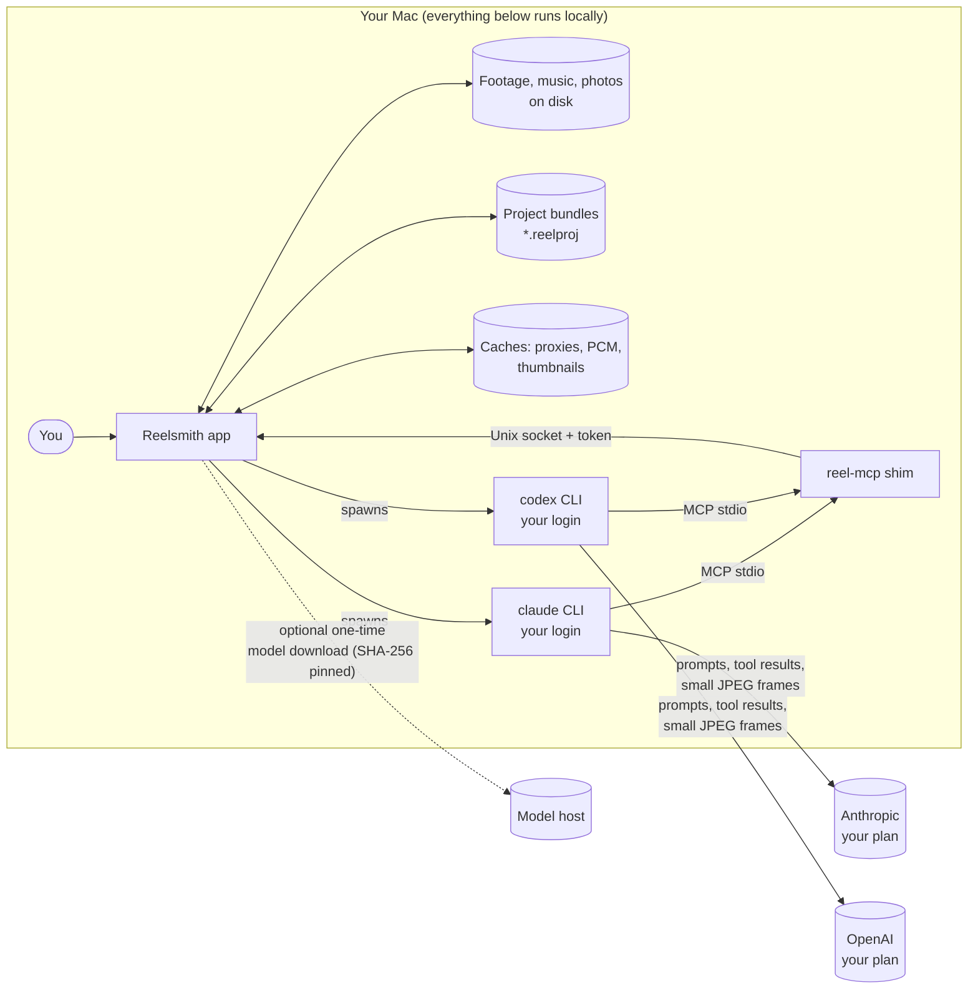

## 2. Processes and IPC

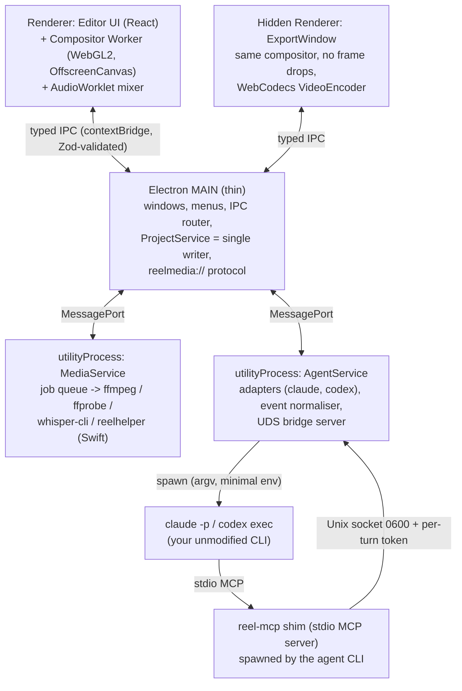

## 3. Package dependencies (dependencies point downward only)

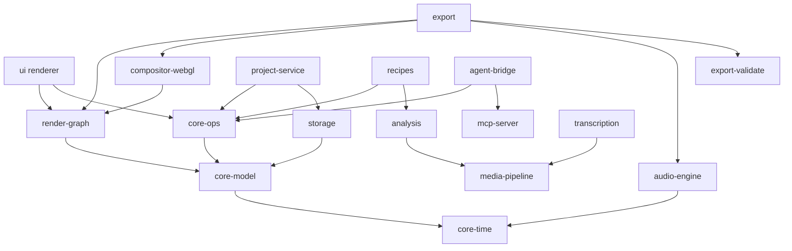

## 4. Data model (simplified)

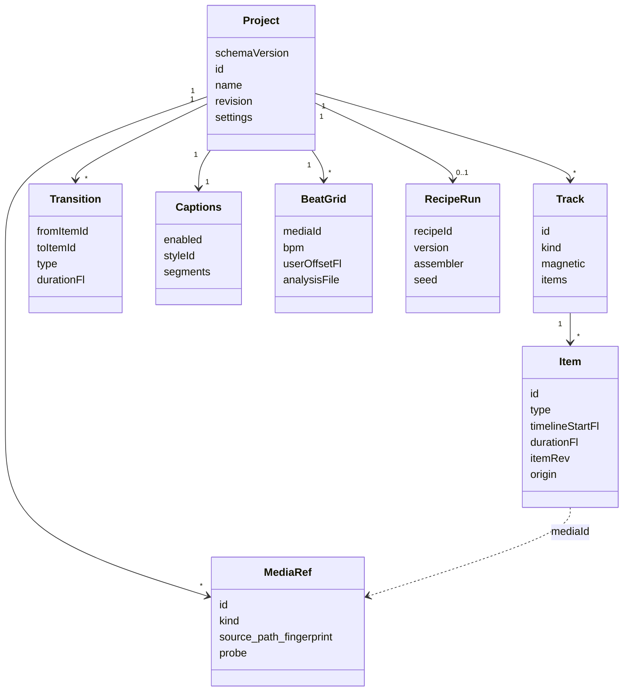

## 5. Import pipeline (per file)

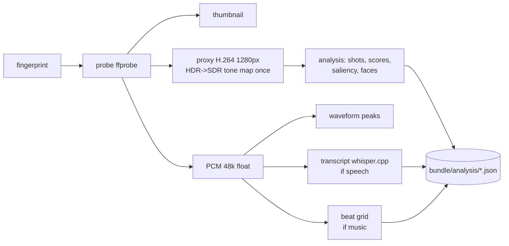

## 6. Recipe assembly (optional agent selection)

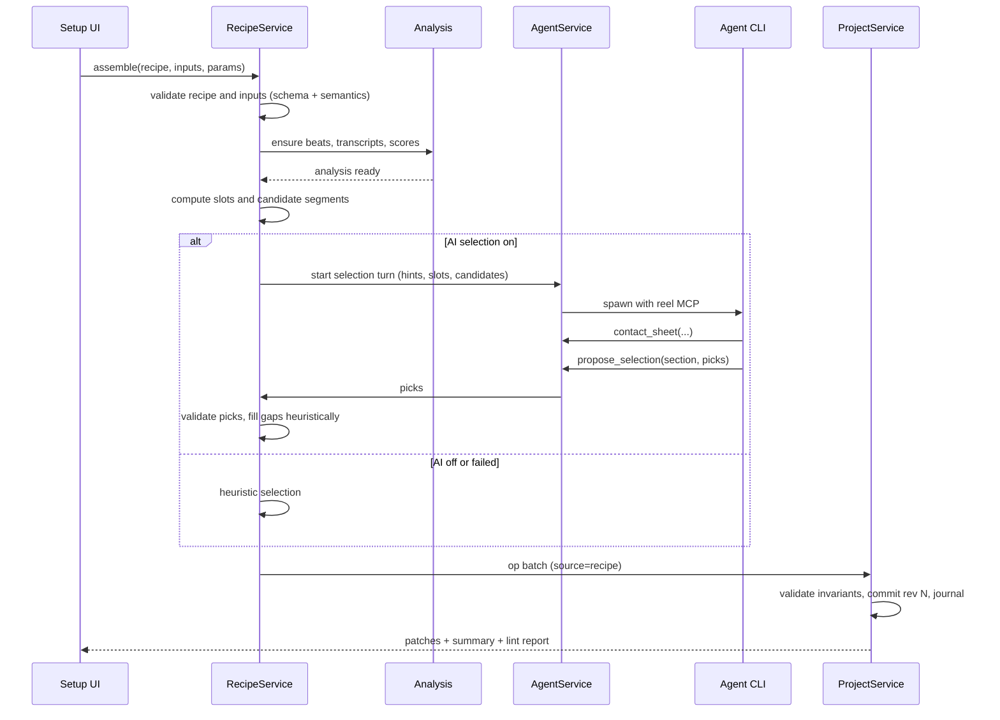

## 7. Chat edit turn

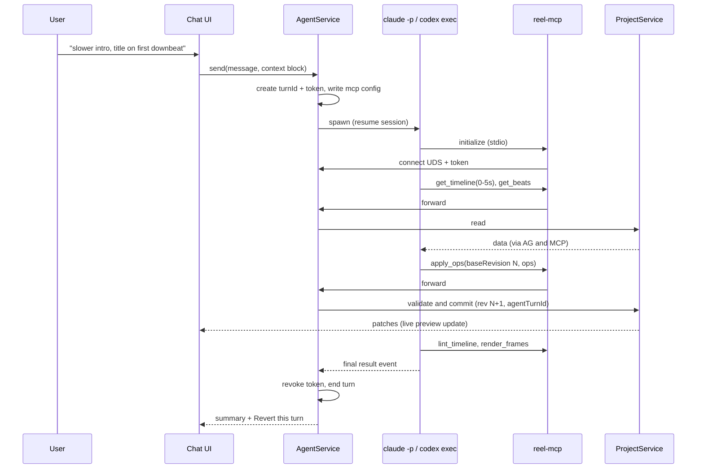

## 8. Export and validation

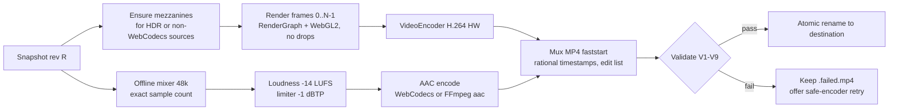

## 9. Agent turn state machine

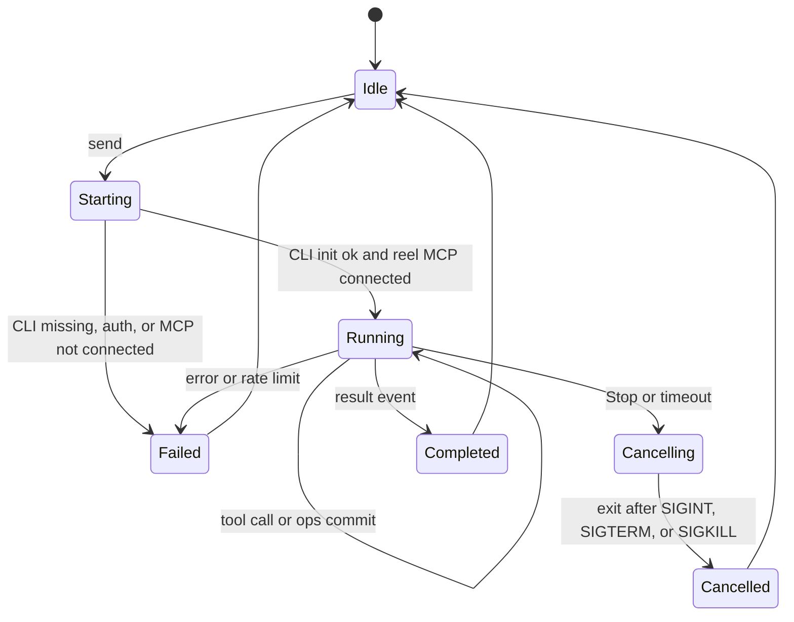

## 10. Media job state machine

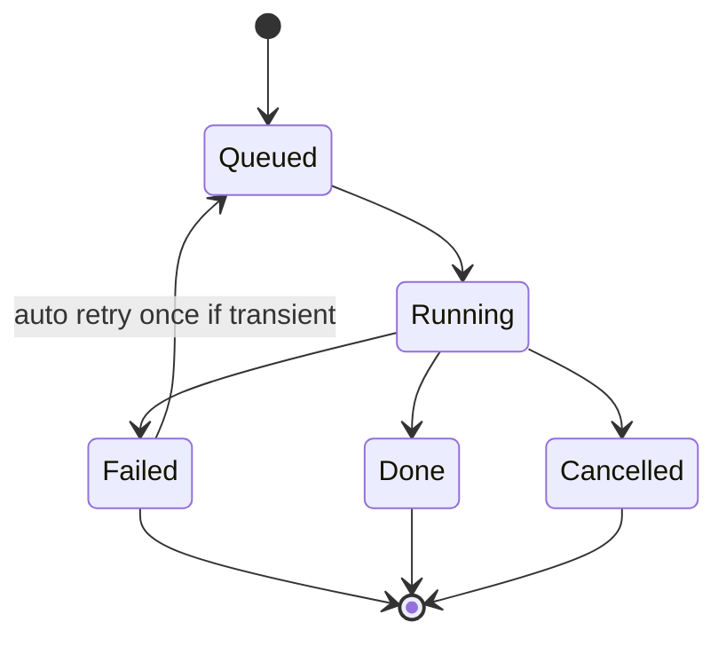

## 11. Bundle and storage layout

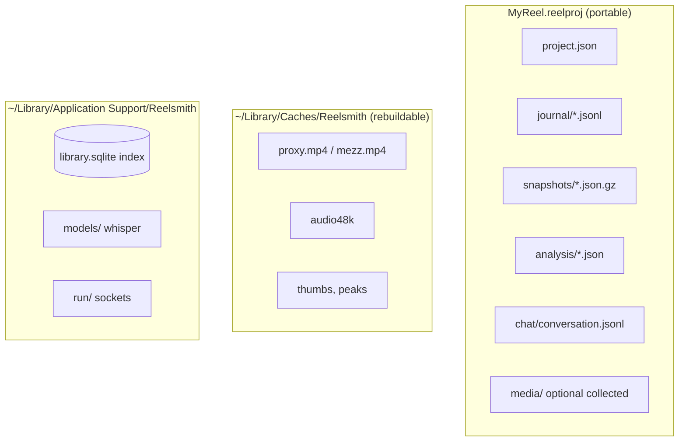
